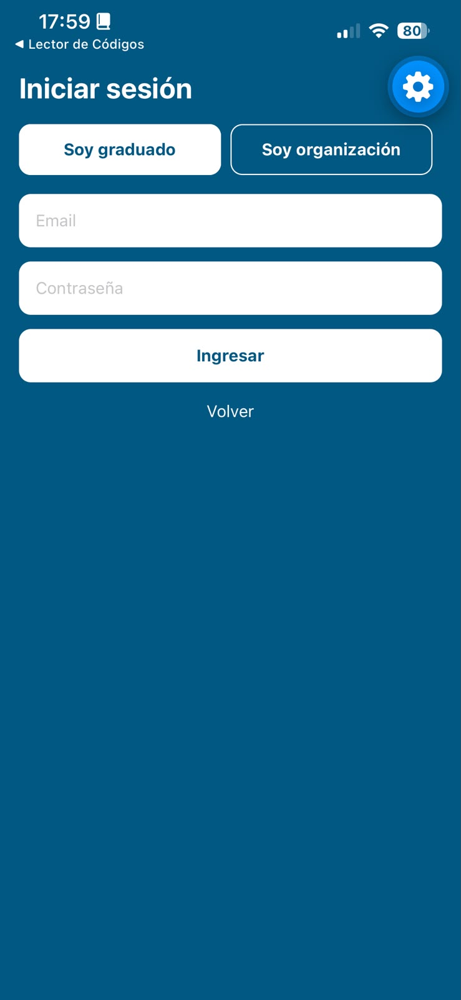
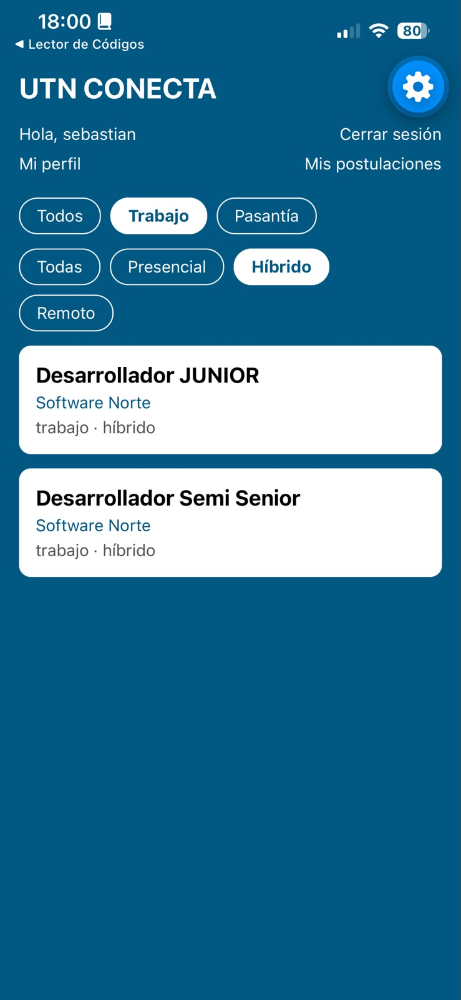
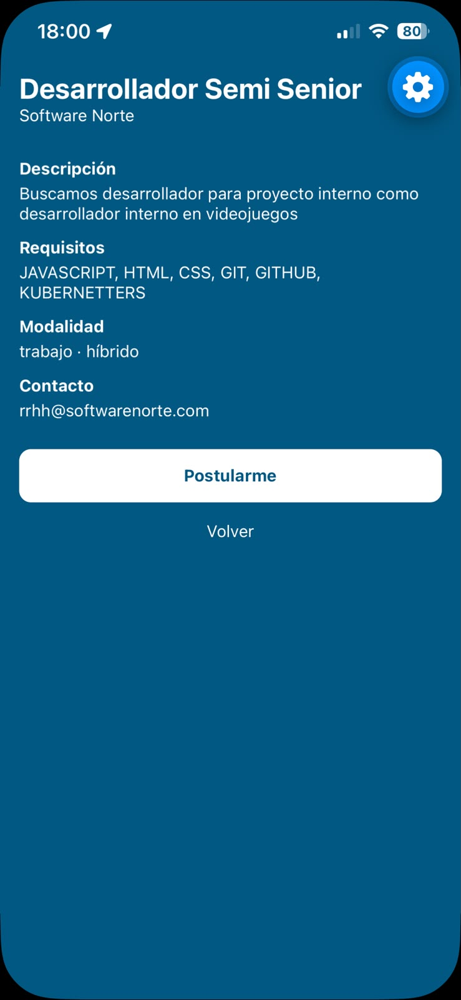
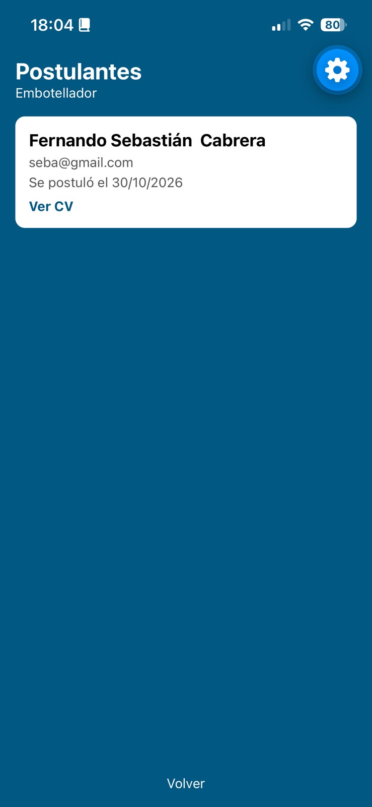

# UTN Conecta

Aplicación móvil que conecta a graduados de la UTN con oportunidades laborales y pasantías publicadas por organizaciones.

Proyecto integrador de la Tecnicatura Universitaria en Programación (UTN FRT).

<p align="center">
  
  
  
  
</p>

## El problema

Al recibirse, un graduado busca trabajo en portales generales donde se mezclan ofertas de todos los rubros, y sin contactos le cuesta llegar a su primera oportunidad. Las organizaciones, por su parte, no tienen un canal directo hacia graduados de la UTN.

## Qué hace

**Graduado**
- Inicia sesión y edita su perfil, con enlace a su CV.
- Ve las oportunidades activas y las filtra por tipo y modalidad.
- Se postula con un toque y sigue sus postulaciones.

**Organización**
- Publica oportunidades de trabajo o pasantía.
- Ve sus publicaciones y quién se postuló a cada una, con el CV del postulante.

## Tecnologías

| Capa | Tecnología |
| --- | --- |
| API | ASP.NET Core (.NET 10), C# |
| Datos | PostgreSQL + Entity Framework Core |
| Seguridad | JWT con roles (graduado / organización) |
| App móvil | React Native con Expo |
| Pruebas | Postman |

## Seguridad

- Autenticación con **JWT** y autorización por rol: cada endpoint verifica quién puede usarlo.
- Una organización solo puede ver los postulantes de **sus propias** oportunidades.
- Validación de datos en el servidor: campos obligatorios, email único y formato de enlaces.
- Probado en Postman: accesos sin token (**401**), con el rol equivocado (**403**) y recursos inexistentes (**404**).
- Las credenciales y la clave JWT **no están en el repositorio**: van en archivos de configuración locales excluidos con `.gitignore`.

## Estructura

```
UTNConecta.API/     API REST en ASP.NET Core
utn-conecta-app/    App móvil en React Native (Expo)
docs/               Capturas y documentación
```

## Cómo ejecutarlo

**Requisitos:** .NET 10 SDK, PostgreSQL, Node.js y la app Expo Go en el celular.

**1. API**
1. Crear la base de datos `utn_conecta` en PostgreSQL.
2. En `UTNConecta.API`, crear `appsettings.Development.json` con la cadena de conexión y la clave JWT (no se incluye en el repositorio).
3. Aplicar las migraciones y levantar la API:
   ```bash
   dotnet ef database update
   dotnet run --launch-profile https
   ```

**2. App**
1. En `utn-conecta-app/src/config.js`, poner la IP local de la computadora donde corre la API.
2. Instalar y levantar:
   ```bash
   npm install
   npx expo start
   ```
3. Escanear el código QR con Expo Go. El celular y la computadora tienen que estar en la misma red Wi-Fi.

## Estado

Funciona de punta a punta: inicio de sesión, publicación, filtros, postulación y consulta de postulantes.

**Próximas mejoras**
- Rol administrador que apruebe organizaciones y valide graduados.
- Subida del CV como archivo PDF.
- Editar y cerrar oportunidades desde la app.
- Despliegue en la nube y contenedores con Docker.

## Autor

**Fernando Sebastián Cabrera** · [LinkedIn](https://www.linkedin.com/in/fernando-sebastian-cabrera-a1499a222/) · [GitHub](https://github.com/SebastianCabrera1902)
